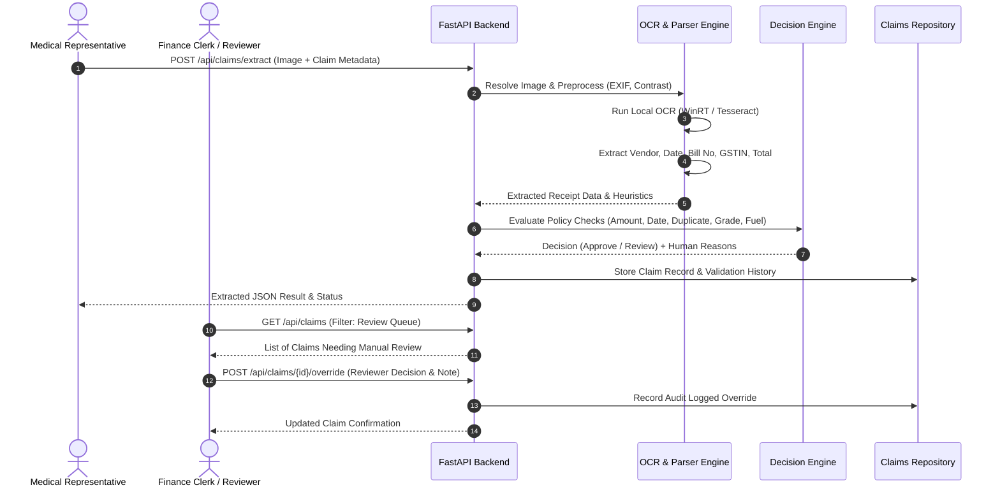

# Tarang Expense Intelligence — System Architecture

## 1. System Overview

**Tarang Expense Intelligence** is an enterprise-grade automated receipt processing and expense validation platform designed specifically for Tarang Pharma Distribution (Nagpur Division). The system processes expense claims submitted by ~160 field medical representatives, extracts five critical financial fields from receipt photographs using a 100% local, zero-cost OCR pipeline, cross-validates the claims against company policies, and generates auditable approval/review decisions.

```
                              ┌───────────────────────────────────┐
                              │     Field Medical Representatives │
                              │    (Expense Claims & Receipts)    │
                              └─────────────────┬─────────────────┘
                                                │
                                                ▼
┌────────────────────────────────────────────────────────────────────────────────────────┐
│                                 FASTAPI BACKEND SERVICE                                │
│                                                                                        │
│  ┌─────────────────────────┐     ┌────────────────────────┐     ┌───────────────────┐  │
│  │  Image Resolver & Pre-  │ ──> │ Local OCR Engine       │ ──> │ Extraction Parser │  │
│  │  processor (PIL/EXIF)   │     │ (WinRT OCR / Tesseract)│     │ (Regex & Heuristic│  │
│  └─────────────────────────┘     └────────────────────────┘     └─────────┬─────────┘  │
│                                                                           │            │
│  ┌─────────────────────────┐     ┌────────────────────────┐               │            │
│  │ Employee Master DB      │     │ Historical Claim Index │               │            │
│  │ (Grade, Vehicle No, HQ) │     │ (Duplicate Detection)  │               │            │
│  └────────────┬────────────┘     └───────────┬────────────┘               │            │
│               │                              │                            │            │
│               └───────────────────────┐      │      ┌─────────────────────┘            │
│                                       ▼      ▼      ▼                                  │
│                          ┌────────────────────────────────────────┐                    │
│                          │      Policy Validation Engine          │                    │
│                          │ (Field Expense Policy v3.2 Compliance) │                    │
│                          └───────────────────┬────────────────────┘                    │
│                                              │                                         │
│                                              ▼                                         │
│                          ┌────────────────────────────────────────┐                    │
│                          │   Decision Service (Approve / Review)  │                    │
│                          └───────────────────┬────────────────────┘                    │
└──────────────────────────────────────────────┼─────────────────────────────────────────┘
                                               │
                                               ▼
┌────────────────────────────────────────────────────────────────────────────────────────┐
│                        TARANG EXPENSE INTELLIGENCE FRONTEND                            │
│                     (React 18 + TypeScript + Vite + TailwindCSS)                       │
│                                                                                        │
│  ┌─────────────────┐   ┌───────────────────┐   ┌────────────────┐   ┌───────────────┐  │
│  │ Dashboard KPIs  │   │ Receipt Workbench │   │ Review Queue   │   │ ROI Analytics │  │
│  └─────────────────┘   └───────────────────┘   └────────────────┘   └───────────────┘  │
└────────────────────────────────────────────────────────────────────────────────────────┘
```

---

## 2. Component Architecture

### 2.1 Backend Pipeline (`backend/app/`)

The backend is built with **FastAPI** (Python 3.13) following clean domain-driven architecture:

1. **Image Resolver & Preprocessor (`ocr/engine.py`):**
   - **Path Resolution:** Robust 5-tier fallback handling raw paths, Windows backslashes (`\`), POSIX slashes (`/`), lowercase/uppercase casing, base filenames, alternative image extensions (`.jpg`, `.jpeg`, `.png`), and custom image directory overrides.
   - **Missing Upload Guard:** Detects absent receipt photographs (such as the 20 missing train uploads and 3 missing test uploads) and safely emits an unreadable status without crashing or fabricating results.
   - **Image Enhancement:** Evaluates EXIF tags to automatically correct orientation, converts RGBA to RGB, resizes high-DPI smartphone photos while preserving aspect ratio, and applies contrast/sharpness enhancement via Pillow.

2. **Local OCR Engine Bridge (`ocr/engine.py` & `scripts/ocr_winrt.ps1`):**
   - **Primary Engine:** Windows Native WinRT OCR (`Windows.Media.Ocr.OcrEngine`), leveraging the OS's built-in machine-learning OCR engine. Operates at ~0.20s per receipt with zero network latency, zero API costs, and full offline execution.
   - **Secondary Fallback:** Standard Tesseract OCR via `pytesseract` when installed on Linux/Docker deployments.
   - **Fallback Simulator:** A structured graceful degradation mode when neither engine binary is accessible, alerting administrators with clear setup instructions.

3. **Field Extraction Parser (`ocr/parser.py`):**
   - **Vendor Extraction:** Scans receipt header lines (top 20% of bounding space), tests against a verified Nagpur/Maharashtra vendor dictionary, strips noise tokens (e.g., "TAX INVOICE", "CASH MEMO"), and calculates heuristic confidence based on token frequency and position.
   - **Date Extraction & Normalization:** Robust multi-format parser supporting Indian conventions (`DD/MM/YYYY`, `DD-MM-YYYY`, `DD.MM.YYYY`, `YYYY-MM-DD`, `DD Mon YYYY`), digit-level OCR spacing repairs (e.g., `2 8 - 0 7 - 2 0 2 6`), and ISO-8601 normalization (`YYYY-MM-DD`).
   - **Receipt / Invoice / AWB Number:** Identifies invoice labels (`Inv No`, `Bill No`, `Receipt #`, `AWB No`, `Ticket No`) and extracts structured alphanumeric identifiers.
   - **GSTIN Extractor:** Strict 15-character statutory format regex (`\d{2}[A-Z]{5}\d{4}[A-Z]{1}[1-9A-Z]{1}Z[0-9A-Z]{1}`) with context scoring to prevent confusing GSTINs with vehicle registrations, phone numbers, or bank account numbers.
   - **Total Payable Amount:** Multi-pass window parser locating total keywords (`TOTAL`, `GRAND TOTAL`, `NET AMOUNT`, `AMOUNT PAYABLE`, `ROUND OFF`, `BILL VALUE`), stripping currency labels (`Rs.`, `INR`, `₹`), prioritizing the highest valid total line, and deliberately excluding subtotals, tax rows (CGST/SGST), discounts, and change returned.

4. **Policy Validation Engine (`rules/decision_engine.py`):**
   - Executes 14 discrete policy and verification checks based on *Tarang Field Expense Policy v3.2*:
     - `receipt_readable`: Checks if OCR successfully extracted minimal receipt data.
     - `amount_match`: Compares extracted amount with representative claimed amount within a ₹10 tolerance.
     - `vendor_match`: Compares extracted vendor with claimed vendor using fuzzy token similarity.
     - `date_match`: Ensures receipt date matches the claimed expense date within a 2-day margin.
     - `possible_duplicate`: Detects duplicate receipt numbers across the company database (e.g., detecting duplicated bill `VX11449697`).
     - `lodging_gstin_present`: Enforces statutory tax invoice requirements for hotel/lodging claims.
     - `lodging_within_grade_limit`: Validates hotel tariff ceilings by employee grade (M1: ₹2,000; M2: ₹2,500; M3: ₹3,500; M4: ₹5,000; M5: ₹7,000).
     - `fuel_vehicle_matches`: Cross-references fuel claims against the employee's registered vehicle number in `employees.csv`.
     - `food_limit_check`: Ensures food expenses above ₹2,500 have regional manager pre-approval.
     - `under_threshold`: Flags claims ≤ ₹2,000.
     - `threshold_checks_passed`: Ensures claims under ₹2,000 satisfy all integrity checks before auto-approval.

5. **Claims Service & Reviewer Overrides (`rules/claims_service.py`):**
   - In-memory repository with pagination, filtering, full-text search, and batch execution capabilities.
   - Audit-logged manual override system allowing authorized finance reviewers to reclassify decisions with required explanatory audit notes.

---

## 3. Frontend Architecture (`frontend/src/`)

Built with modern **React 18**, **TypeScript**, **Vite**, and **Tailwind CSS**:

- **A. Executive Dashboard (`components/Dashboard.tsx`):**
  - KPI metric cards (Total Processed, Auto-Approved, Review Queue, Missing Receipts, Amount Mismatches, Duplicates).
  - Expense category breakdown and quick action workbench.
- **B. Interactive Receipt Processing (`components/ReceiptProcessing.tsx`):**
  - Drag-and-drop receipt uploader with live image preview.
  - Interactive claim information submission form.
  - Field-by-field OCR extraction viewer with heuristic confidence badges.
  - Live side-by-side comparison against claimed representative inputs.
  - Policy check list with instant approve/review badges and human-readable decision reasons.
- **C. Review Queue (`components/ClaimsQueue.tsx`):**
  - Paginated table of all submitted claims.
  - Filter by Decision (`All`, `Approve`, `Review`), Category (`Fuel`, `Food`, `Lodging`, `Travel`, `Stationery`, etc.), and Search term.
  - Visual flags for duplicate bills and amount mismatches.
- **D. Claim Detail Modal & Reviewer Override (`components/ClaimDetailModal.tsx`):**
  - High-resolution receipt image viewer.
  - Complete employee master profile (Designation, Grade, Headquarter, Registered Vehicle No).
  - Detailed checklist breakdown showing exact failed checks.
  - Finance reviewer override modal requiring reviewer identity and justification notes.
- **E. Analytics & ROI Model (`components/Analytics.tsx`):**
  - Real computed pipeline metrics (approval rate, review rate, mismatch rate).
  - Financial ROI analysis model calculating clerical hours released, capacity value in ₹, and query delay avoidance.
- **F. Settings & Policy Configuration (`components/SettingsModal.tsx`):**
  - Configurable auto-approval threshold (`₹2,000`), amount tolerance (`₹10`), food limit (`₹2,500`), and grade limits.
  - OCR engine status monitor and dataset statistics.

---

## 4. Data Flow



---

## 5. Security, Isolation, and Error Handling

1. **Zero Secret Leakage:** No third-party cloud API keys are required or stored in environment files. All processing occurs on the local host.
2. **Crash Resilience:** Every image load and OCR operation is wrapped in granular try/except blocks. Corrupt image files or missing photos are gracefully recorded with diagnostic warnings.
3. **CORS Isolation:** Development servers strictly configure CORS origins (`localhost:5173`, `localhost:3000`).
4. **Audit Trail:** Any change to an automated decision is logged with the reviewer's name, timestamp, and mandatory business reason.
